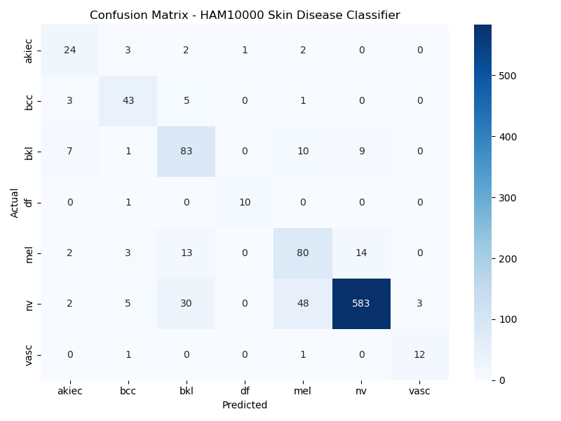

# Skin Disease Classifier (HAM10000)

A deep learning model for classifying 7 types of skin lesions from dermoscopy images, using transfer learning on EfficientNet-B0.

## Overview

- **Dataset:** [HAM10000](https://www.kaggle.com/datasets/kmader/skin-cancer-mnist-ham10000) — 10,000+ labeled dermoscopy images across 7 classes
- **Model:** EfficientNet-B0 (pretrained on ImageNet), fine-tuned in 3 phases
- **Test Accuracy:** 83%
- **Framework:** PyTorch, trained on RTX 2050 (CUDA)

## Classes

| Code | Disease |
|------|---------|
| akiec | Actinic keratoses |
| bcc | Basal cell carcinoma |
| bkl | Benign keratosis-like lesions |
| df | Dermatofibroma |
| mel | Melanoma |
| nv | Melanocytic nevi |
| vasc | Vascular lesions |

## Approach

1. **Data split:** 80% train / 10% validation / 10% test (stratified by class)
2. **Class imbalance:** Handled via `WeightedRandomSampler` (nevus makes up ~67% of the dataset)
3. **Training:** 3-phase progressive fine-tuning
   - Phase 1: Frozen backbone, train classifier head only
   - Phase 2: Unfreeze last 2 EfficientNet blocks, fine-tune at lr=1e-4
   - Phase 3: Unfreeze last 3 blocks, fine-tune at lr=5e-5 with early stopping
4. **Augmentation:** Random flips, color jitter, rotation

## Results

**Test set classification report:**

| Class | Precision | Recall | F1-score |
|-------|-----------|--------|----------|
| akiec | 0.63 | 0.75 | 0.69 |
| bcc | 0.75 | 0.83 | 0.79 |
| bkl | 0.62 | 0.75 | 0.68 |
| df | 0.91 | 0.91 | 0.91 |
| mel | 0.56 | 0.71 | 0.63 |
| nv | 0.96 | 0.87 | 0.91 |
| vasc | 0.80 | 0.86 | 0.83 |

**Overall accuracy: 83%** | Macro F1: 0.78



### Notes on errors

Misclassifications concentrate among visually similar pigmented lesion types — melanoma, nevus, and benign keratosis are frequently confused with one another, which mirrors a known diagnostic challenge in dermatology rather than indicating random model error. Rare classes (dermatofibroma, vascular lesions) achieved high recall thanks to weighted sampling during training.

## Setup

\`\`\`bash
conda create -n skindx python=3.10
conda activate skindx
pip install -r requirements.txt
\`\`\`

## Training

See `train.ipynb` / `train.py` for the full training pipeline.

## API

Run the inference server:
```bash
uvicorn main:app --reload
```
Then open `http://127.0.0.1:8000/docs` to test via Swagger UI.

**Endpoint:** `POST /predict` — upload a dermoscopy image, returns:
```json
{
  "disease": "Melanoma",
  "code": "mel", 
  "confidence": 69.3,
  "top3": [...]
}
```

## Live API
Base URL: `https://skin-disease-classifier-production.up.railway.app`

- `GET /health` — server status
- `POST /predict` — upload image, get prediction
- `GET /docs` — interactive Swagger UI

## iOS App (SwiftUI)

A native iOS client that sends images to the live API and displays the result.

### Features

- Pick a photo from the library (PhotosPicker) or capture one with the camera
- Image is resized/compressed on-device before upload
- Multipart upload to /predict using async/await and URLSession
- Result card with predicted disease, confidence bar, top-3 predictions, and a short description
- High-concern classes (mel, bcc, akiec) are highlighted with a "see a dermatologist" warning
- Live server status indicator (via /health)
- Medical disclaimer shown in-app

## Status

- [x] Data preprocessing and augmentation
- [x] Model training (transfer learning, 3-phase fine-tuning)
- [x] Evaluation (confusion matrix, classification report)
- [x] FastAPI inference endpoint
- [x] Docker + Railway deployment(live)
- [x] SwiftUI iOS app(in progress)

## Future Work
- Grad-CAM heatmaps to visualize what the model focuses on
- On-device inference with Core ML (offline mode)
- Improve melanoma recall/precision with a larger or external dataset
- Prediction history and export in the app